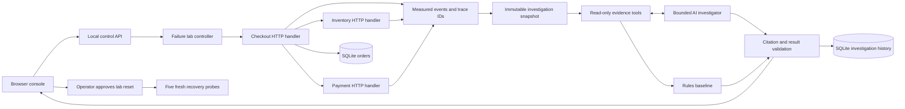

# IncidentLens

**Break a checkout application. Investigate the evidence. Verify the recovery.**

IncidentLens is an incident investigation workbench with a controlled HTTP/SQLite failure lab, a bounded AI tool-calling investigator, and an explicit deterministic baseline. Every diagnosis links to observed evidence; recovery requires an operator action and fresh probes.

## Run in 30 seconds

Requires Python 3.11 or newer. The local app and baseline have **zero third-party runtime dependencies**.

```bash
git clone https://github.com/mariapreethi-12/incidentlens.git
cd incidentlens
python -m incidentlens.server
```

Open **http://127.0.0.1:8787**. Choose **Retry amplification**, click **Inject & collect traffic**, then **Run investigation**. Expand the tool execution trace and click evidence citations. Approve the lab reset to verify five fresh checkouts.

The server binds only to loopback. This version is a local engineering lab, not a public multi-user deployment. It needs authentication, isolation, request quotas, and a production HTTP server before public hosting.

## What actually executes

- Checkout makes real loopback HTTP calls to inventory and payments, then writes an order to SQLite.
- A database contention scenario holds an actual exclusive SQLite transaction.
- The payment dependency returns HTTP 503 during an outage.
- The latency scenario delays the inventory handler by 180 ms.
- The regression executes a missing-field lookup, raising a real `KeyError`.
- The retry scenario makes four payment attempts per checkout during an outage.
- Timings, statuses, messages, and shared trace IDs are recorded from those executions.

Service handlers share one process and one local HTTP server. They are **not independently deployed microservices**. Faults and traffic are intentionally controlled, and the trace format is application-specific rather than OpenTelemetry. This keeps the lab easy to reproduce while preserving observable failures.

## Architecture



### Investigator modes

| Mode | Execution | API key |
| --- | --- | --- |
| Rules baseline | Deterministic rules over the four evidence sources | No |
| AI agent | OpenAI Responses API; the model chooses read-only tool calls | Yes |
| AI single-pass | Same bounded evidence bundled into one model request | Yes |

The agent sees metrics, recent logs, correlated request spans, and change records. It does **not** receive the fault setting or scenario label. Supported diagnosis categories are known to all investigators; this is classification over known fault families, not unrestricted discovery.

### Enable the AI investigator

Set both variables in the shell used to start the server. Choose a model your account supports with Responses API function calling. No model is silently selected for you.

PowerShell:

```powershell
$env:OPENAI_API_KEY = '<your key>'
$env:OPENAI_MODEL = '<your model ID>'
python -m incidentlens.server
```

macOS/Linux:

```bash
export OPENAI_API_KEY='<your key>'
export OPENAI_MODEL='<your model ID>'
python -m incidentlens.server
```

Alternatively, copy `.env.example` to `.env` in the project directory and fill in both settings. The server and evaluation CLI load these two settings automatically at startup; existing environment variables take priority. `.env` is excluded from Git. Restart the server after changing configuration. Model requests transmit the controlled lab evidence to OpenAI and incur usage charges. The browser never receives the key. Provider failures are surfaced; they never turn into a fake successful AI diagnosis.

The adapter uses the [official Responses function-calling protocol](https://developers.openai.com/api/docs/guides/function-calling): function calls execute against an allowlist, results return using matching call IDs, and output items are retained for subsequent turns. Requests set `store: false`.

### Boundaries and budgets

- Maximum eight agent API turns and sixteen read-only tool calls.
- Tool arguments must be empty objects; no SQL, shell, arbitrary URLs, or write tools.
- Model output must use an allowed category, include a summary and next steps, and cite evidence it actually retrieved.
- A valid citation proves that the record exists, **not** that it causally supports the conclusion.
- A benign deployment annotation is included to discourage treating every change as the cause.
- Insufficient evidence is an allowed outcome; an empty sample makes the baseline abstain.
- Recovery resets all controlled faults. It is an operator-approved lab reset, **not an AI-generated production fix**.
- Recovery approval is bound to the current run and cannot be replayed. New probes or scenarios invalidate the report.

## Tests and evaluations

```bash
python -m unittest discover -s tests -v
python -m incidentlens.evaluate --mode baseline --repeats 3
python -m incidentlens.evaluate --mode agent --repeats 3 --output results/agent.json
python -m incidentlens.evaluate --mode single-pass --repeats 3 --output results/single-pass.json
```

Model modes require the environment settings above and make paid calls. Reports are written to `results/`; API failures count as incorrect. Usage includes input and output token counts. Dollar costs are not estimated because pricing depends on the selected model and token classes.

Local verification on Windows/Python 3.13: **13 tests passed**. Live OpenAI evaluations used `gpt-4.1-mini` on November 4, 2026.

| Investigator | Correct / trials | Mean investigation time | Input / output tokens |
| --- | --- | --- | --- |
| Rules baseline | 18 / 18 | See raw results | 0 / 0 |
| AI tool-calling agent | 12 / 12 | 4.42 seconds | 44,698 / 4,926 |
| AI single-pass | 12 / 12 | 3.25 seconds | 38,291 / 4,670 |

Each AI mode ran two trials per condition; baseline ran three. The single-pass approach was faster and used fewer tokens in this sample. **This experiment does not establish an advantage for the agent.** No prompt caching or dollar-cost comparison is claimed. Timings exclude failure injection and traffic collection and include local evidence processing and API calls.

Raw results: [baseline](docs/baseline-evaluation.json), [agent](docs/agent-evaluation.json), [single-pass](docs/single-pass-evaluation.json). A [sample live AI investigation](docs/sample-ai-investigation.json) includes the actual evidence and tool-call trace. The dashboard recovery check passed five fresh checkout probes.

These are controlled known fault families, not held-out generalization or production accuracy. The first live smoke run misclassified retry amplification as a payment outage. We clarified the category definitions before collecting the tabulated results. That [original miss](docs/development-smoke.json) is preserved and discussed in [the evaluation notes](docs/EVALUATION.md). The rules and prompt were developed for these scenarios.

Tests cover real faults and recovery, abstention, fourfold retry amplification, fabricated citations, unauthorized tools, tool budgets, model function-call round trips using a fake transport, provider failure handling, concurrent operation rejection, stale/repeated approvals, HTTP assets and origin checks.

## Repository map

```text
incidentlens/
  lab.py        Actual HTTP handlers, SQLite faults, telemetry and probes
  agent.py      Evidence tools, rules baseline and model tool loop
  server.py     Local control API, history persistence and web assets
  evaluate.py   Repeatable labeled fault trials
  web/          Responsive dashboard, citations and tool execution trace
tests/          Integration and protocol tests
docs/           Evaluation results, design decisions and demo notes
.github/        CI test matrix and evaluation artifacts
```

Raw live telemetry stays in memory; order data and investigation reports persist under `data/`. Report history is stored but not yet browsable from the dashboard. Metrics summarize the current run, so recovery success is verified from fresh probes separately from the historical error rate.

## Next engineering milestones

1. Expand the live comparisons to additional models and repeat counts; publish failures as well as successes.
2. Add held-out fault variants, noisy and missing telemetry, multiple simultaneous faults, and prompt-injection cases.
3. Export OpenTelemetry spans and move service handlers to independently deployed containers.
4. Add authenticated public demo sessions, quotas, bounded telemetry retention, and model cost budgets.

See [docs/DEMO.md](docs/DEMO.md) for a walkthrough and [docs/DESIGN.md](docs/DESIGN.md) for decisions and interview discussion points.
